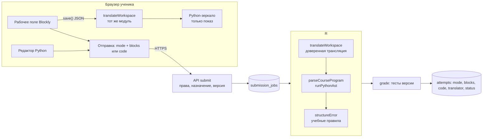

# Архитектура адаптивного обучения Kodik B2B

Статусы: **Есть / PoC / План / Открыто / Отложено** (см. BLOCKLY_B2B_AUDIT.md).

## 1. Принцип

**Одно задание → несколько представлений → одна проверка → прогресс по навыкам и уровню помощи.**

```
Задание (одна сущность, одна опубликованная версия)
 ├─ Содержание: условие, теория, подсказки ..................... Есть
 ├─ Эталон, тесты, типичные ошибки, учебные правила ............ Есть
 ├─ learning_config ............................................ План
 │    ├─ skills: подтверждённые навыки
 │    ├─ modes: blocks | mixed | python (разрешённые)
 │    ├─ palette: типы блоков
 │    ├─ starter_blocks: стартовое поле, по умолчанию пустое
 │    └─ translator: версия транслятора на момент публикации
 └─ Политика адаптации — в назначении группе, не в задании ...... План
```

Режимы не копируют задание. Тесты, эталон, учебные правила и проверка качества **общие**. Различается только представление: какое поле видит ученик и что он отправляет.

## 2. Поток данных



| Звено | Статус | Решение |
|---|---|---|
| Трансляция в браузере для зеркала | PoC | Тот же `blockProgram.ts`, что и на сервере. Расхождение версий исключено сборкой из одного исходника |
| Отправка | План | Для `blocks` / `mixed` клиент отправляет **только JSON блоков**. Python, если пришёл, игнорируется. Тест PoC: «server ignores client-supplied Python» |
| Где выполнять трансляцию | План | **Внутри процесса-исполнителя** (`runner-entry.ts`): недоверенный JSON разбирается там же, где недоверенный код, с теми же ограничениями памяти и времени. Сервер получает обратно сгенерированный Python и сохраняет его в попытку |
| Исполнение и проверка | Есть, PoC для блоков | Существующий `grade()` / `execute()`, очередь и тесты без изменений |
| Учебные правила | Есть, PoC для блоков | Тот же structural checker по сгенерированному Python |

Почему трансляция в исполнителе, а не в API-процессе:
1. изоляция — разбор недоверенных данных не идёт в процессе с доступом к БД;
2. один бандл `runner.cjs` — версия транслятора совпадает с версией интерпретатора, их можно включить в `runtimeHash()` проверки качества.

## 3. Режимы и уровни помощи

| Режим | Что видит ученик | Что отправляет | Статус |
|---|---|---|---|
| `blocks` | Поле Blockly с палитрой задания | JSON блоков | PoC |
| `mixed` | Blockly + Python-зеркало его блоков с подсветкой строки выбранного блока | JSON блоков | PoC |
| `python` | Существующий редактор B2B | Код | Есть |
| `guided` (код с подсказкой) | Python с готовыми строками, редактируемы только пропуски | Код | План, v2 |
| `assembly` (сборка кода) | Перестановка готовых строк Python (Parsons) | Порядок строк → код | План, v2 |

`guided` и `assembly` — представления того же задания. Проверка у них общая (`grade()` по полученному коду), разное только поле ввода. Заготовку пропусков и строк Kodik предлагает из эталона, преподаватель правит. Это задача этапа после пилота.

### Методическая проверка порядка этапов — Открыто

В B2C порядок `blocks → blocks_with_code → guided_code → code_tokens → free_code`. Исследования Parsons-задач (Parsons & Haden, 2006; Ericson, Margulieux, Rick, 2017) показывают: сборка кода из готовых строк в среднем **быстрее и легче**, чем дописывание пропусков. Поэтому порядок `guided` раньше `tokens` выглядит инвертированным.

Предложение для проверки с преподавателем: **Блоки → Блоки + Python → Сборка кода → Код с подсказкой → Свой Python**.

Отдельно — режим «чтение кода» (`recognition`: что выведет программа?). Он полезен перед любым письмом и не требует ввода кода. Порядок не захардкожен: это упорядоченный список в конфигурации (ADAPTIVE_RULES.md).

## 4. Прогресс и навыки

Источник истины — попытки. Отдельная таблица «освоено» в первой версии не нужна.

```
попытка = (ученик, назначение, версия, режим, уровень помощи, статус, навыки версии)
навык × режим ученика = агрегат по попыткам:
  разные принятые задания, доля без подсказок, последняя дата
```

| Правило | Статус |
|---|---|
| Успех в `blocks` засчитывается только для навыка в режиме `blocks`. Для `python` нужен отдельный успех в `python` | План |
| Подсказки на сервере не учитываются (PD-18). Уровень помощи в первой версии = режим + факт открытия подсказок, если появится серверный учёт | Открыто |
| Клики и время не считаются доказательством знания | План |

## 5. Безопасность

| Угроза | Защита | Статус |
|---|---|---|
| Клиент присылает правильный Python, а блоки — неправильные | Сервер транслирует блоки сам, текст клиента игнорирует | PoC |
| Огромный или глубокий граф, «бомба» в мутации, цикл ссылок | Лимиты размера, числа блоков, глубины, веток; отказ без исключения | PoC |
| Блок вне палитры (обход учебной цели) | Палитра версии проверяется при трансляции | PoC |
| Неподдерживаемая конструкция | Белый список; блоков с непроверенным соответствием нет | PoC |
| Раскрытие эталона в смешанном режиме | Зеркало показывает только код из блоков ученика. В ученическом DTO остаются только `modes`, `palette`, `starter_blocks` из `learning_config` | PoC (UI); План (DTO) |
| Чужая школа или чужой ученик | Существующие проверки `org_id` и назначения не меняются | Есть |
| Исполнение | Тот же процесс с `--permission`, 48 МБ, дедлайном и лимитом вывода | Есть |

## 6. Расширяемость исполнителя

Транслятор выдаёт **текст Python**, а не вызывает интерпретатор напрямую. Если в будущем появится изолированный CPython (ARCHITECTURE.md), блоки смогут исполняться им без изменений. Сменить нужно только белый список: какие блоки разрешены для какого исполнителя.

## 7. Чего не делаем — Отложено

- Обратная трансляция Python → блоки для редактирования (кроме анализа эталона).
- Двустороннее редактирование в смешанном режиме.
- AI-адаптация.
- Произвольный Python и сторонние библиотеки.
- Изменение учебного интерпретатора в рамках этой работы.
