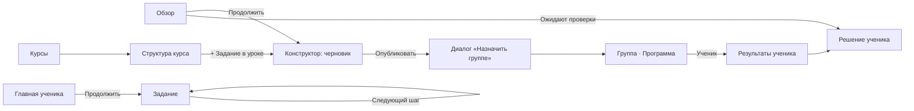

# Информационная архитектура Kodik B2B (десктоп)

Основной размер — 1440 × 900. Проверочные размеры: 1280 × 800, 1366 × 768, 1920 × 1080. Мобильная навигация не проектируется.

## 1. Роли и среды

| Роль | Среда | Навигация | Плотность |
|---|---|---|---|
| Преподаватель | Рабочий кабинет | Боковая панель 240 px, 5 пунктов | Компактная |
| Администратор школы | Тот же кабинет + раздел «Школа» | 5 пунктов + «Школа» | Компактная |
| Ученик | Учебная среда | Верхняя панель 64 px, 3 пункта; в задании — без панели | Свободная |

Видимость пунктов — только удобство. Права по-прежнему проверяет сервер (`server/b2b/app.mjs`), ученические DTO не содержат скрытых тестов, эталонов и заметок.

## 2. Навигация преподавателя

```
Kodik ─┬─ Обзор
       ├─ Курсы ──────── Курс ── Модуль ── Урок ─┬─ Сценарий урока (шаги)
       │                                         └─ Задание → Конструктор
       ├─ Группы ─────── Группа ─┬─ Ученики ── Ученик
       │                         ├─ Программа (выданные уроки и задания)
       │                         └─ Результаты группы
       ├─ Задания ────── Конструктор (новое / черновик / опубликованное)
       └─ Результаты ─── Матрица ── Решение ученика (код, тесты, оценка)

Профиль (низ панели): имя, роль, выход
Школа (только admin): Преподаватели · Ученики · Подписка (концепт, вне MVP)
```

Изменения относительно текущего меню:

- «Учебные группы» → «Группы».
- «Участники» убраны из основного меню: ученики живут в группах, преподаватели — в «Школе».
- Карточка «Лаборатория Kodik» (исходный курс) переезжает в меню профиля → «Исходный курс Kodik».

## 3. Навигация ученика

```
Kodik ─┬─ Главная ── «Продолжить» → Задание / Шаг урока
       ├─ Мои курсы ── Курс (путь уроков) ── Урок ── Шаг / Задание
       └─ Прогресс (выполнено, навыки, следующий шаг)
Задание: полноэкранная среда, «← К курсу», режим фокуса
```

## 4. Перечень экранов и соответствие маршрутам

| Экран | Текущий маршрут | Статус |
|---|---|---|
| Вход | `/` | Переоформить |
| Обзор преподавателя | `#overview` | Переделать содержание (см. §6) |
| Курсы — список | `#courses` | Таблица/список + поиск + фильтр «Черновик / Опубликован» |
| Курс — структура | `#courses/:id` | Дерево Модуль → Урок → Шаг/Задание, перестановка |
| Сценарий урока | `#lesson-editor/:id` | Переоформить в «ленту шагов» |
| Задания — список | `#tasks` | Таблица с курсом, уроком, статусом проверки качества |
| Конструктор | `#builder/new`, `#builder/:id` | Один экран: оглавление разделов слева, быстрое создание + «Расширенные настройки» в центре, живой предпросмотр справа (PD-01) |
| Предпросмотр | `#preview/:id` | Встраивается в конструктор; отдельный маршрут остаётся для полного экрана |
| Группы — список | `#groups` | Список групп с метриками |
| Группа | новый `#groups/:id` | Вкладки: Ученики / Программа / Результаты |
| Программа группы | `#program/:id` | Вкладка группы |
| Ученики и роли | `#users` | Перенос: ученики → группа, преподаватели → Школа |
| Результаты | `#results` | Матрица + «Требуют внимания» + история решений |
| Решение ученика | диалог `AttemptDialog` | Боковая панель поверх матрицы |
| Школа (admin) | новый `#school` | Преподаватели, места, подписка |
| Главная ученика | `#overview` (student) | Новый экран (§7) |
| Курс ученика | `#courses` (student) | Путь уроков |
| Урок ученика | `#lesson-run/:id` | Переоформить |
| Задание ученика | `#assignment/:id` | Трёхчастная среда без сайдбара |
| Прогресс ученика | `#results` (student) | Новый экран |

## 5. Главные сценарии и переходы



Правила переходов:

- Кнопка «Назад» всегда возвращает в исходный контекст, например в урок курса, а не в общий список. Фильтры и прокрутка списков сохраняются в URL.
- Создание задания из урока подставляет урок в конструктор.
- После публикации сразу предлагается назначить задание группе — одно модальное окно, без перехода.
- Несохранённые изменения: автосохранение уже есть. При уходе со страницы с ошибкой сохранения появляется диалог «Остаться / Уйти без сохранения».

## 6. Обзор преподавателя — порядок блоков

1. **Требуют внимания** — решения «На проверке» и ученики, у которых после трёх попыток нет успеха. Максимум 5 строк, ссылка «Все». Пусто → «Проверять нечего» (одна строка, без иллюстрации).
2. **Мои группы** — до 6 карточек: название, учеников, текущее открытое занятие, доля выполнивших.
3. **Продолжить работу** — последние 3 изменённых черновика или курса.
4. **Последняя активность** — последние 8 решений: кто, что, результат, время.
5. **Быстрые действия** (в шапке страницы): «Создать задание», «Создать группу».

Онбординг (нет курсов, групп и заданий) заменяет блоки 1–4 чек-листом из пяти шагов (§8).

## 7. Главная ученика

Одна главная кнопка — «Продолжить: <название задания>». Под ней:

- текущий курс и путь уроков (позиция «7 из 12»);
- назначенные задания со сроком (до 5);
- освоенные навыки — из `learningRules` и пройденных тем.

Счётчика попыток и рейтингов нет.

## 8. Онбординг преподавателя

Чек-лист на «Обзоре», не тур:

1. Создать первый курс → `#courses` + диалог.
2. Добавить урок → структура курса.
3. Создать задание → конструктор с уроком.
4. Создать группу → `#groups` + диалог.
5. Пригласить учеников → вкладка «Ученики» группы.

Шаги отмечаются по реальным данным: есть курс, есть урок и т. д. Кнопка «Скрыть» сворачивает чек-лист в строку «Настройка: 2 из 5» в шапке «Обзора», откуда его можно вернуть. Хранение флага — `localStorage` на пользователя; серверный флаг — в плане.

## 9. Матрица состояний экранов

Для каждого ключевого экрана есть: норма, пусто (с действием), загрузка (skeleton той же формы), ошибка загрузки («Повторить»), нет доступа (403 → объяснение и «На главную»), успех действия (toast 4 с, `role="status"`).

Конструктор дополнительно:

| Состояние | Индикатор в шапке | Действия |
|---|---|---|
| Новый черновик | «Черновик · не сохранён» | Автосохранение после первого ввода |
| Сохранено | «Сохранено · 12:40» | — |
| Сохраняется | «Сохраняем…» | — |
| Ошибка сохранения | Красная плашка «Не сохранено. Изменения в браузере» | «Повторить», блокировка ухода |
| Конфликт | Диалог сравнения (уже есть) | Выбрать версию |
| Тесты некорректны | Шаг «Проверка» с красной меткой, список причин | «Перейти к тесту» |
| Предпросмотр | Правая панель в режиме ученика | «Запустить как ученик» |
| Опубликовано | «Опубликовано · версия 3» | «Назначить группе», «Снять с публикации» (с подтверждением) |
